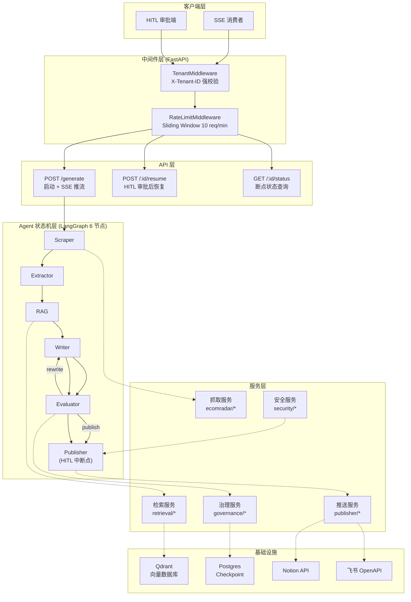
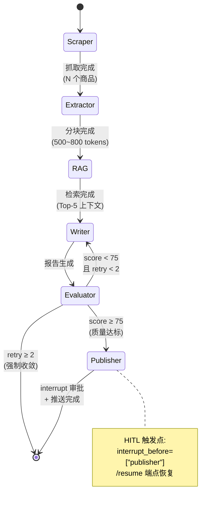
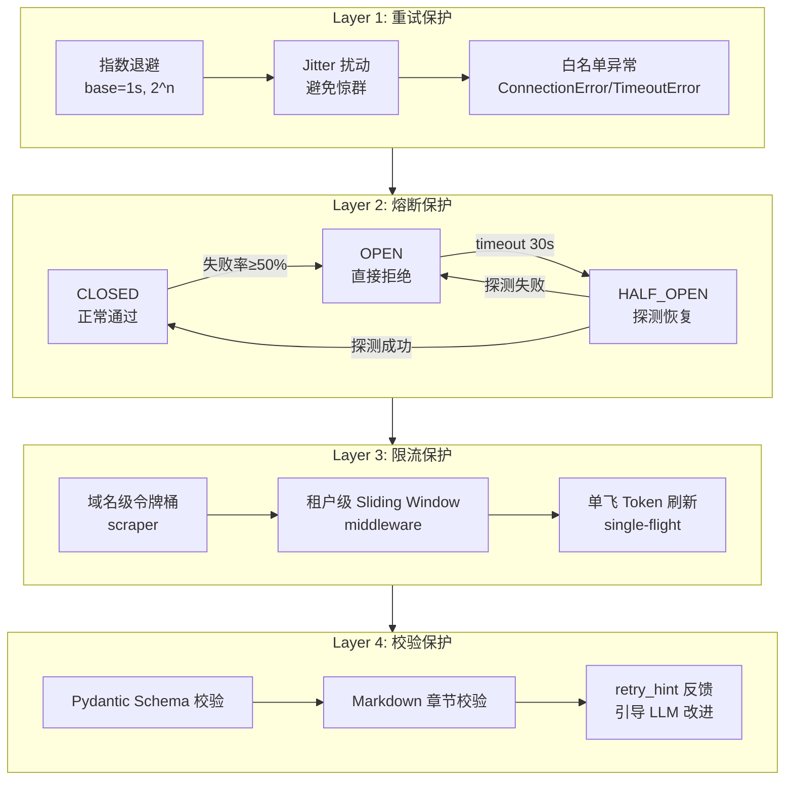
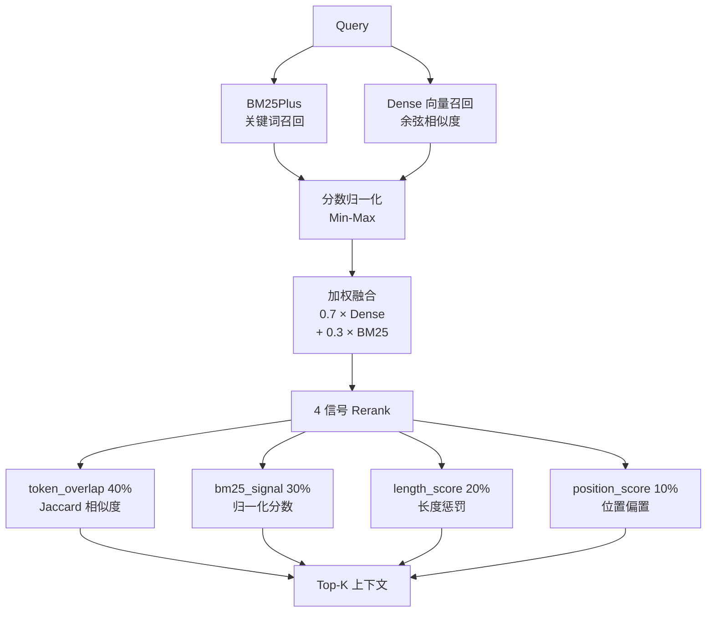
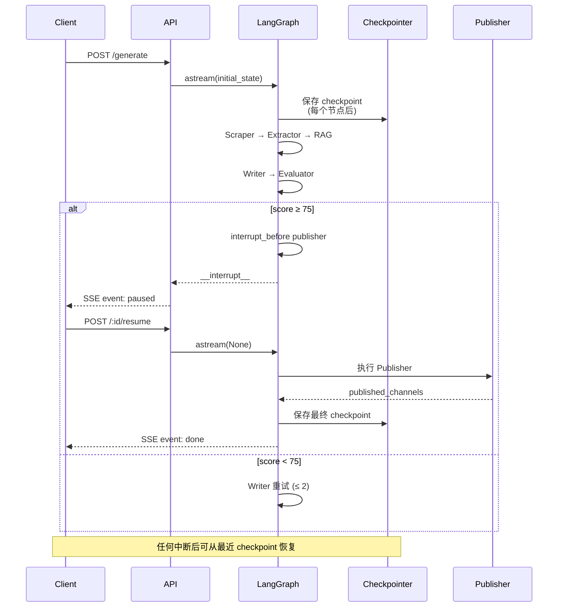
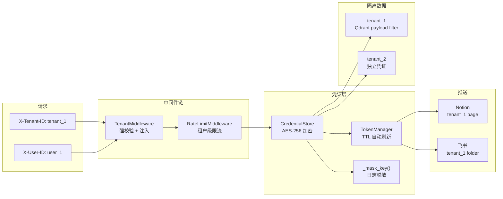
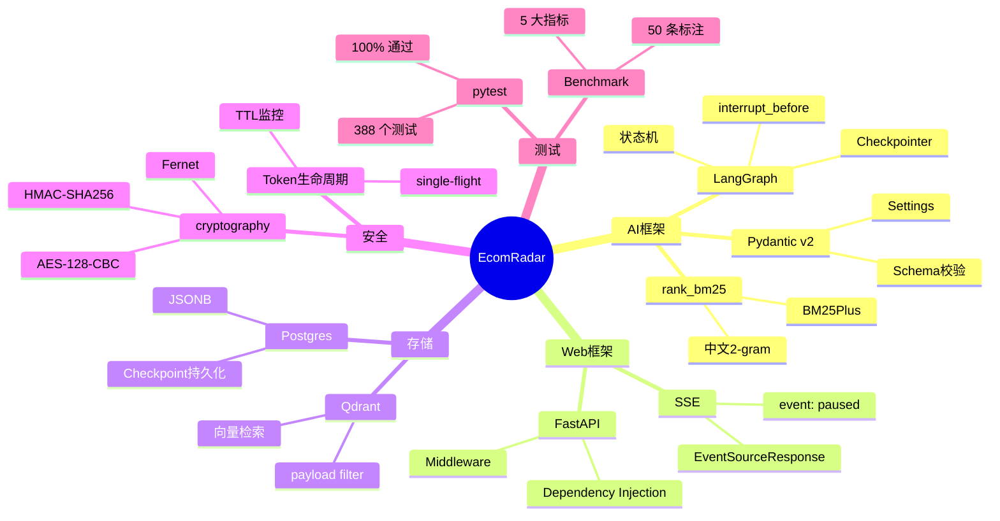

# EcomRadar 架构图

## 1. 全局架构(4 层)

---

## 2. 6 节点状态机流转

---

## 3. 数据流(抓取 → 检索 → 生成)

```mermaid
flowchart LR
    subgraph INPUT["输入"]
        I["商品 URL 列表"]
    end

    subgraph SCRAPE["抓取层"]
        S1["robots.txt 检查"]
        S2["令牌桶限流<br/>≤ 1 req/s"]
        S3["HTTP 抓取<br/>UA 池轮换"]
        S4["jina reader 兜底"]
        S5["mock 数据兜底"]
        S1 --> S2 --> S3
        S3 -.失败.-> S4
        S4 -.失败.-> S5
    end

    subgraph PARSE["解析层"]
        P1["平台识别<br/>jd/tmall/pdd/douyin"]
        P2["字段抽取<br/>标题/价格/SKU/销量"]
        P1 --> P2
    end

    subgraph RETRIEVE["检索层"]
        R1["BM25Plus<br/>关键词召回"]
        R2["Dense 向量召回"]
        R3["加权融合<br/>0.7*Dense + 0.3*BM25"]
        R4["4 信号 Rerank<br/>token/bm25/length/position"]
        R5["元数据过滤"]
        R6["语义去重<br/>Jaccard/SimHash"]
        R1 --> R3
        R2 --> R3
        R3 --> R4 --> R5 --> R6
    end

    subgraph GENERATE["生成层"]
        G1["Writer Node<br/>品牌识别 + 品类推断"]
        G2["LLM 生成<br/>4 段式报告"]
        G3["Evaluator<br/>5 维度评分"]
        G4["75 分门控<br/>retry ≤ 2"]
        G1 --> G2 --> G3 --> G4
    end

    subgraph PUBLISH["推送层"]
        PU1["Markdown → Notion Blocks"]
        PU2["飞书文档创建"]
        PU3["Publisher Node"]
        PU1 --> PU3
        PU2 --> PU3
    end

    I --> S1
    S5 --> P1
    S4 --> P1
    S3 --> P1
    P2 --> R1
    P2 --> R2
    R6 --> G1
    G4 --> PU3
```

---

## 4. 治理机制(可靠性 4 层防护)

---

## 5. 检索管道(混合检索)

---

## 6. 数据持久化与状态恢复

---

## 7. 多租户与凭证安全

---

## 8. 技术栈分布

---

## 关键设计决策

| 决策 | 选择 | 理由 |
|------|------|------|
| 状态持久化 | LangGraph MemorySaver + 自定义 CheckpointStore | LangGraph 官方接口兼容 + 业务层灵活扩展 |
| 熔断算法 | 滑动窗口失败率 | 相比固定窗口更准确,避免瞬时抖动误触发 |
| 检索融合 | 0.7 Dense + 0.3 BM25 | 偏向语义,兼顾关键词精确匹配 |
| Rerank 信号 | token/bm25/length/position 4 信号 | 轻量级,无需加载 BGE 模型(1GB+) |
| 凭证加密 | Fernet (AES-128-CBC + HMAC) | 工业标准,自带完整性校验 |
| 降级策略 | mock 数据兜底 | 保证演示不中断,失败可审计 |
| HITL 触发 | interrupt_before publisher | 关键外部操作前人工确认 |
| 评测指标 | EM + F1 + ROUGE-L + Latency | 覆盖准确性/相关性/性能 3 维度 |

---

**最后更新**: 2026-10-14
**版本**: Phase 8 完成版
**Commit**: `bd87157`